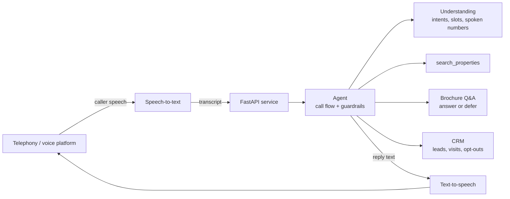

# Real-Estate Voice Sales Agent

[](https://github.com/AroneBenedict/realestate-voice-agent/actions/workflows/ci.yml)

A voice AI agent that calls a home buyer, qualifies them (area, BHK, budget, timeline),
recommends matching projects, answers brochure questions without guessing, and books a site
visit into a CRM. It is built for what breaks voice agents in practice: speech-recognition
errors, callers who go off-script, and replies that must be short enough to be spoken.

It was tested on 24,000 simulated phone calls with known answers, at four levels of
speech-recognition error.



## A call

What the agent heard is the speech recogniser's output, so numbers arrive as words and
"Whitefield" arrives as "white feel".

```text
Agent:  Hi, this is Asha from Sample Realty. You had enquired about a new home in Bengaluru.
        Is this a good time to talk for two minutes?
Caller: yes go ahead
Agent:  Which area of Bengaluru are you looking at?
Caller: i'm looking in white feel
Agent:  Just to confirm, you're looking in Whitefield, right?
Caller: yes
Agent:  How many bedrooms do you need: 1, 2, 3 or 4 B H K?
Caller: two bhk
Agent:  What budget do you have in mind?
Caller: around one crore
Agent:  And when are you planning to buy: in the next few months, or later?
Caller: in the next couple of months two months
Agent:  Let me confirm: a 2 B H K in Whitefield, budget 90 lakh to 1.1 crore, buying in the
        next three months. Is that right?
Caller: yes
Agent:  I found two 2 B H K options: Ivory Heights in Whitefield, 92.6 lakh to 98.8 lakh,
        ready June 2027; and Dewdrop Greens in Whitefield, 96 lakh to 1.1 crore, ready to move.
        Would you like to book a site visit?
Caller: is there a swimming pool
Agent:  No, the brochure for Ivory Heights doesn't list a swimming pool. It has badminton
        court, power backup, co-working space, gym, children's play area. Would you like to
        book a site visit?
Caller: yes let's book a visit for saturday
Agent:  May I have your name, please?
Caller: my name is priya
Agent:  Shall I send the confirmation to this number, ending 2 3 4 5?
Caller: yes
Agent:  Done, Priya. Your site visit to Ivory Heights is booked for Saturday. You'll get a
        confirmation on your number ending 2345. Is there anything else I can help with?
```

The CRM now holds a lead scored "hot", with the requirements, both projects of interest and
the booked visit.

## Results

1,000 held-out simulated calls per cell. Word error rate (WER) is the share of caller words
the simulated speech recogniser mishears, drops or pads with a filler. Full tables in
[`results/REPORT.md`](results/REPORT.md).

| Agent | WER 0% | WER 5% | WER 10% | WER 20% |
|---|---|---|---|---|
| **Full agent** | **99.9%** | **99.9%** | **99.1%** | **94.8%** |
| Without confirmations (read-backs) | 99.9% | 89.7% | 80.2% | 65.4% |
| Without spoken-number parsing | 18.4% | 18.4% | 18.4% | 18.4% |

A call counts as a success only if every check passes: the right outcome, all four
requirements captured, only matching projects recommended, correct booking details, every
brochure question answered correctly or honestly deferred, and no guardrail violation.

- **Guardrail violations: 0** across all 24,000 calls. No invented prices, no discount
  promises, no legal advice, no full phone numbers read aloud, no reply too long to speak.
- **Opt-outs handled: 100%.** "Don't call me again", "not interested", "talk to a person"
  and "call me later" each end the call correctly and update the CRM.
- **Brochure questions: 97.0% correct at 20% WER**, and when a brochure does not cover
  something (pets, for half the projects) the agent says so instead of guessing.

### What the failures taught

The numbers above come from studying failed calls one at a time on separate development
callers, then fixing the cause:

- **Speech recognisers write numbers as words.** "Eighty five lakh" and "nine eight four..."
  matched no digit pattern. Without spoken-number parsing only the calls that end early
  succeed (18.4%).
- **A dropped word silently changes a number.** "One point three crore" heard as "one three
  crore" became 3 crore. The agent now flags garbled or implausible amounts and reads them
  back, and confirms all four requirements once before searching. Confirmations are worth
  29 points of task success at 20% WER (65.4% to 94.8%).
- **Ten spoken digits rarely survive intact.** On an outbound call the agent already knows
  the number, so it offers that instead of asking for dictation; when a different number is
  needed it takes it in two halves.
- **Callers drop the question word.** "The metro close by" has no "what" or "is". The agent
  now routes any utterance with a clear brochure topic to the brochure.
- **Name extraction was too eager.** "I am in a meeting" produced a caller named "In". Only
  explicit introductions count now.

Two features had no measurable effect in this simulator and are reported as such: fuzzy
locality matching (the agent re-asks instead, at the cost of a turn) and the two-part phone
capture (most simulated calls use the dialled number).

## Quickstart

```bash
pip install -e ".[dev]"
pytest --cov                                     # 72 tests
python -m voiceagent.evaluate --calls 100        # about 10 seconds
uvicorn voiceagent.api:app --port 8000
```

```bash
curl -X POST localhost:8000/calls -H 'content-type: application/json' -d '{"caller_number": "9845012345"}'
curl -X POST localhost:8000/calls/<call_id>/turn -H 'content-type: application/json' -d '{"text": "yes go ahead"}'
curl localhost:8000/calls/<call_id>      # transcript (numbers masked), slots and tool trace
curl localhost:8000/leads
```

## How it works

| Part | Module | What it does |
|---|---|---|
| Understanding | `nlu.py` | Intents (question, discount, legal, opt-out, callback, human...) and slots (area, BHK, budget, timeline, purpose, name, phone, day) from noisy transcripts: spoken numbers, budget ranges in lakh and crore, known mishearings of locality names, speech fillers. |
| Agent | `agent.py` | The call flow, one question at a time; read-backs of anything uncertain; requirement summary before searching; brochure answers; site-visit booking; lead scoring; a full tool trace. |
| Tools | `catalog.py`, `crm.py` | Property search with nearby-area fallback and a 10% budget stretch; brochure Q&A (BM25 topic match, answer only from stored facts); CRM interface for leads, visits and opt-outs. |
| Voice | `voice.py` | Speech-to-text and text-to-speech interfaces; reply rewriting for TTS ("2 BHK" to "2 B H K", "km" to "kilometres", prices in lakh/crore); a speech-error simulator. |
| Guardrails | `guardrails.py` | Every reply is checked before it is spoken: prices must exist in the catalogue, no promises or advice, no full phone numbers, at most 55 words. Phone numbers are masked in transcripts. |
| LLM agent | `llm.py`, `prompts/persona.md` | The same tools exposed to Claude through tool calling, with a persona and rules prompt, and the same guardrails on every reply. |
| Evaluation | `simulate.py`, `evaluate.py` | Simulated callers with hidden requirements and behaviours (asks questions, wants a discount, busy, not interested, wants a human, opts out), passed through the speech-error simulator; ablations of each robustness feature. |
| Service | `api.py` | FastAPI endpoints for a voice platform, a leads view and Prometheus-format counters. |

## Limitations

- **No real speech yet.** The agent works on transcripts. Speech-to-text and text-to-speech
  are interfaces here, not integrations, and speech errors are simulated, not recorded.
  Connecting a voice platform is the next step.
- **The callers are simulated.** They answer in varied phrasings and misbehave on purpose,
  but they were written alongside the agent, and they read the agent's `expecting` field to
  know what was asked. Real callers ramble, interrupt and change their minds more. The
  numbers show the design holds up under speech errors; they do not predict live conversion.
- **The catalogue is fictional:** 22 projects across 11 Bengaluru localities. No project,
  developer or registration number is real.
- **The LLM agent is unit-tested only**, against a fake API client. It has not been run on
  live calls or benchmarked, so no accuracy is claimed for it.
- **English only.** Many Indian buyers mix Hindi, Kannada or Tamil with English.

## Layout

```
src/voiceagent/   agent, understanding, tools, voice layer, guardrails, LLM agent, API
prompts/          persona and rules for the LLM agent
data/             fictional project catalogue (generated by scripts/make_listings.py)
tests/            72 tests
results/          metrics.json and REPORT.md
docs/             design notes
```

Built AI-first, with Claude as a coding assistant.
